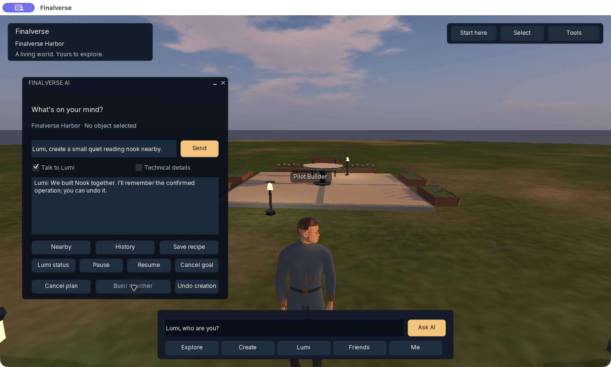

# Finalverse Viewer

An AI-native persistent 3D world client, built incrementally on the mature
open-source Second Life Viewer. Finalverse is the consumer experience;
[MutSea](https://mutsea.com) is the authoritative spatial runtime behind it.

**[Download the Mac developer preview](https://github.com/finalverse/final_viewer/releases/tag/v0.4.0-preview.2)** ·
**[Getting started](docs/finalverse/getting-started.md)** ·
**[Native demos](docs/finalverse/demos.md)** ·
**[Website](https://finalverse.com)**

> Experimental prerelease for developers and invited testers. The Mac package
> is ad hoc signed and **not notarized**. Downloading it does not grant access to
> the private Harbor pilot. Public self-registration and GA support are not open.

## What works today

The client preserves world streaming, avatars, movement, chat, inventory,
permissions, object editing and the existing renderer. The Finalverse facade
adds a simpler entry point for Explore, Create, Lumi, Friends and Me.

On a world that advertises the relevant authenticated capabilities, Create can
inspect structured scene data, propose bounded actions, preview native placement
and permissions, apply an approved operation, inspect WorldLine and undo it.
Recipes support Save, Load and Remix. Primitive placement resolves the person's
native heading and terrain rather than model-generated coordinates.

Hosted Lumi co-building routes through private server-side AI services and
PostgreSQL persistence. It retains explicit controller policy and human approval;
the model never receives arbitrary world-write authority. Current hosting has
one configured Lumi controller, not a public multi-user citizen service.

Actual acceptance: a 147-part reading nook appeared after approval and was
removed through guarded Undo; native counts returned from 570 to the 423-part
baseline. [Screenshots, recap and verification scope](docs/finalverse/demos.md).

## Install, enter a world, and try it

1. Download the DMG and checksum from the GitHub release **Assets**.
2. Follow [Mac installation and signing limitations](docs/finalverse/getting-started.md#2-install-and-open).
3. Request your own Harbor invitation/account at
   [info@finalverse.com](mailto:info@finalverse.com?subject=Finalverse%20preview%20world%20access).
   The account shown in demos is a private fixture, not a shared login.
4. Select Finalverse Harbor (Preview), then sign in only when the operator has
   granted access. Other compatible grids have separate identities/capabilities.
5. Try “What objects are around me?” and a supported creation. Review before
   Apply; inspect History and use supported Undo.

Existing Harbor users can [manage their account at MutSea](https://mutsea.com/account/)
with the same avatar name/password: view home details, edit a web profile, change
the world password and generate recovery codes. Email reset and public signup
remain unavailable. [Account guide](https://github.com/finalverse/mutsea-o/blob/main/docs/mutsea/account-portal.md).

Apple Silicon is the verified runtime. The executable also contains Intel code,
but Intel hardware is not verified. No Linux/Windows/mobile download is included.
Client downloads are hosted by **GitHub Releases**, independently of world hosting.
Updates are manual. [Release notes and limitations](docs/finalverse/releases/0.4.0-preview.2.md).

## Build and contribute

- [Build/package this preview](docs/finalverse/building-preview.md)
- [Architecture and migration record](docs/finalverse/README.md)
- [Hosted placement/Lumi acceptance](docs/finalverse/hosted-lumi-and-placement.md)
- [MutSea server source](https://github.com/finalverse/mutsea-o)
- [Issues](https://github.com/finalverse/final_viewer/issues)

Keep fixes incremental, compatible and testable. Report the release tag,
platform, reproduction steps and relevant evidence. Redact credentials, session
and capability URLs, private conversations and unrelated desktop content.

## License and provenance

Inherited viewer code is authored by Linden Lab and upstream contributors under
[LGPL 2.1](LICENSE), with file-specific notices preserved. Finalverse is an
independent fork, not the official Second Life client. Preserve
[source notices](doc/LICENSE-source.txt), [third-party notices](indra/newview/licenses-mac.txt),
[artwork attribution](doc/LICENSE-logos.txt) and the
[Finalverse branding ledger](indra/newview/branding/README.md).

The release supplies corresponding viewer source, dependency/build provenance
and bundled notices. Brand assets retain their recorded rights; this repository
is not a blanket trademark or third-party asset license. See the
[distribution audit](docs/finalverse/licensing-audit.md).

Verbatim upstream README retained for provenance

<picture>
  <source media="(prefers-color-scheme: dark)" srcset="doc/sl-logo-dark.png">
  <source media="(prefers-color-scheme: light)" srcset="doc/sl-logo.png">
  
</picture>

**[Second Life][] is a free 3D virtual world where users can create, connect and chat with others from around the
world.** This repository contains the source code for the official client.

## Open Source

Second Life provides a huge variety of tools for expression, content creation, socialization and play. Its vibrancy is
only possible because of input and contributions from its residents. The client codebase has been open source since
2007 and is available under the LGPL license. The [Open Source Portal][] contains additional information about Linden
Lab's open source history and projects.

## Download

Most people use a pre-built viewer release to access Second Life. Windows and macOS builds are
[published on the official website][download]. More experimental viewers, such as release candidates and
project viewers, are detailed on the [Alternate Viewers page](https://releasenotes.secondlife.com/viewer.html).

### Third Party Viewers

Third party maintained forks, which include Linux compatible builds, are indexed in the [Third Party Viewer Directory][tpv].

## Build Instructions

[Windows](https://wiki.secondlife.com/wiki/Build_the_Viewer_on_Windows)

[Mac](https://wiki.secondlife.com/wiki/Build_the_Viewer_on_macOS)

[Linux](https://wiki.secondlife.com/wiki/Build_the_Viewer_on_Linux)

## Contribute

Help make Second Life better! You can get involved with improvements by filing bugs, suggesting enhancements, submitting
pull requests and more. See the [CONTRIBUTING][] and the [open source portal][] for details.

[Second Life]: https://secondlife.com/
[download]: https://secondlife.com/support/downloads/
[tpv]: http://wiki.secondlife.com/wiki/Third_Party_Viewer_Directory
[open source portal]: http://wiki.secondlife.com/wiki/Open_Source_Portal
[contributing]: https://github.com/secondlife/viewer/blob/main/CONTRIBUTING.md

