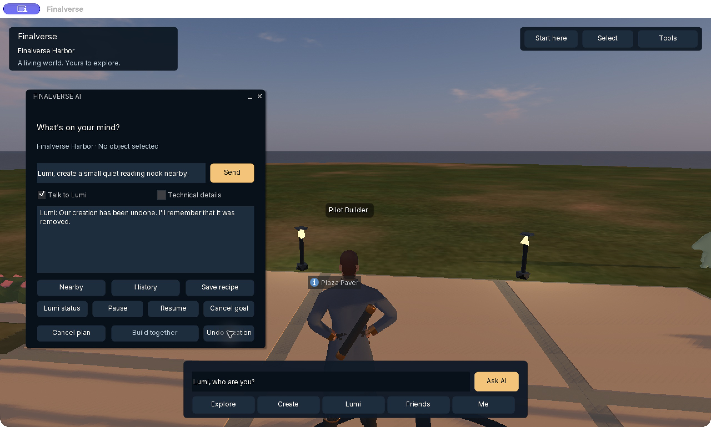

# Native hosted-Lumi demonstration

These are authentic captures from the macOS development client against the
private hosted MutSea pilot on October 15, 2026. They are not target renders,
generated-world concept art or a browser-based world demo.

The tested flow was: enter Harbor → ask Lumi → request a reading nook → review
the structured proposal → approve **Build together** → observe the actual scene
→ **Undo creation** → observe removal and Lumi's acknowledgement.

The proposal grouped 14 library pieces into five kinds of change; native
execution produced 147 parts. Authoritative scene counts were **423 before,
570 after building and 423 after Undo**. Earlier external TLS/login/UDP checks
verified every created part's identity, transform, ownership and semantics after
native/runtime restarts. Hosted citizen identity, completed goals and memory
persist in PostgreSQL. The model proposes; native policy and explicit approval
remain between the proposal and mutation.

The release includes `Finalverse-hosted-Lumi-recap.mp4`: a captioned **still-image
recap** using the two captures above. It is not a continuous screen recording.
Its WebVTT caption file and the unmodified PNGs are also release assets. The
images contain only the named development fixture; no credential or capability
is supplied. Source captures and the recap renderer make the presentation
reproducible.

This proves the bounded private operator workflow. It does not prove public
self-registration, general multi-user citizen ownership, arbitrary natural
language world construction, premium final art or all-device performance.
See [getting started](getting-started.md) for client and world-access requirements.
