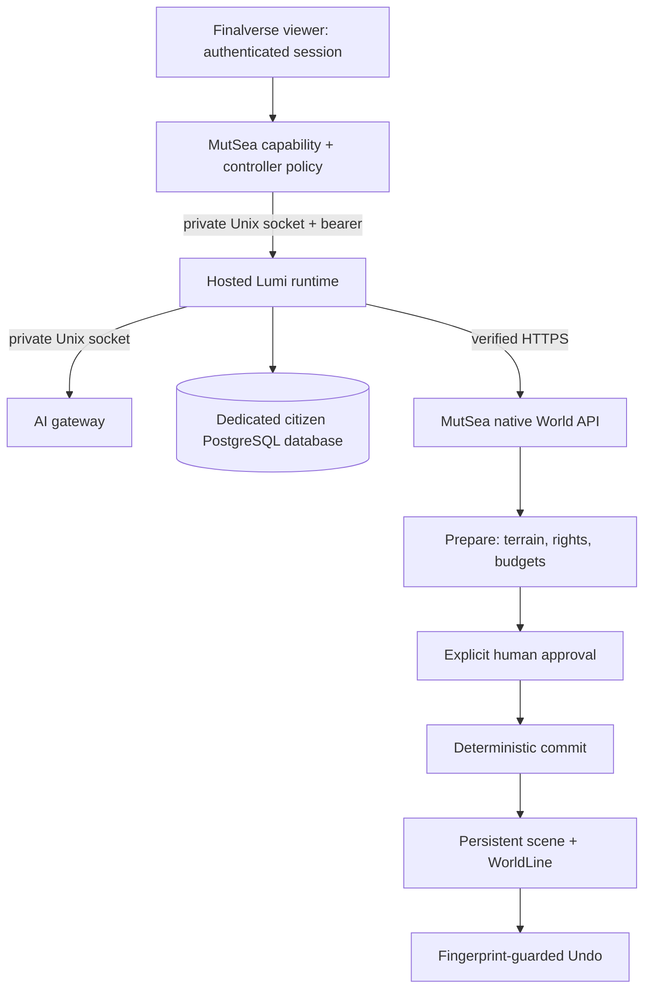

# Deterministic placement and hosted Lumi — 2026-10-15

Status: implemented and deployed to the private hosted pilot. Public downloads
remain on hold under [the release decision](release-readiness-20261015.md).
This increment uses the existing viewer, simulator, composition library,
approval controls, journals and Undo. No renderer or avatar compiler was replaced.

## Delivered behavior

For a bounded primitive request such as “Create a small blue box four meters to
my right,” the gateway extracts a direction/distance descriptor. MutSea resolves
that descriptor from the authenticated avatar's native position and orientation;
the model never chooses the coordinates for this path. Supported directions are
forward, backward, left and right, with distances from 0.5 to 12 meters. An
unspecified site defaults to two meters forward. Contradictory directions,
ambiguous distances and unsupported named-surface requests ask for clarification.
This is a deliberately bounded placement grammar, not general spatial language.

The native solver samples nine terrain points across the primitive footprint,
checks dry ground, slope, region bounds, occupied space and avatar clearance,
and retains existing parcel/ownership/budget validation. A readable siting
description accompanies the preview. Apply uses that exact previewed location;
turning afterward does not reinterpret the command. Changed terrain or scene
state invalidates the preview. Legacy explicit-coordinate actions remain valid.

“Lumi, create a quiet reading nook nearby” now works through a hosted runtime.
Lumi uses the existing composition/WorldSpec and native place validation path,
waits for the controller's approval, then records the resulting operation and
episodic memory. The person owns the resulting scene objects. Completed goals
and memories persist across server/runtime restarts; volatile previews are
discarded and active goals are blocked on recovery. Guarded Undo remains tied
to the original operation. Save a recipe before restarting if it is needed later.

## Authority and transport

All application services run on the same backend host. A second site is only an
external test client. The runtime exposes no public TCP listener, and the
planner remains private. Unix sockets use private directories, mode-0600 socket
files, service identity and existing bearer/controller checks. Missing token,
browser Origin and wrong-controller requests are refused. Model input contains
neither the simulator login credential nor the runtime bearer token.

Hosted Lumi uses a separate database and role in the existing PostgreSQL
instance. A bounded database worker preserves the synchronous storage contract,
atomically writes citizen state/events and holds an advisory single-writer
lease. Local SQLite fixtures remain supported; hosted persistence uses no
SQLite database. Storage errors never authorize replaying uncertain world actions.

The runtime's private connection mapping retains the world URL, TLS hostname
and certificate validation. Never alias the public grid name to a private
Docker address inside the simulator: inherited region networking advertises
that resolved address to external UDP clients. Recreate/restart the runtime
when replacing the simulator container so private connection addresses refresh.
Clients disable redirects/proxies and bound response sizes and deadlines.

## Source and reproducibility

The sibling MutSea repository contains `Finalverse/World/RelativePlacement.cs`,
`PrivateServiceHttp.cs`, the existing world/place executors and
`deploy/standalone/compose.citizens.yaml`. Its adapter Dockerfile builds against
the exact tested native image assemblies. The AI gateway's `placement.py` and
action/plan schemas carry the bounded descriptor. The runtime's `pg_store.rs`
and `transport.rs` implement hosted persistence and IPC without changing the
citizen/wardrobe/animation contracts. No new viewer executable was required:
the current viewer already renders `Prepared.siting` and citizen controls.

Local implementation commits on `codex/worldspec-create`: MutSea
`8ed9aee4cc`, AI gateway `131f5e3`, agent runtime `3ac0422`. These are local
milestones; no public release or Git push was made for this increment.

Before rollout, active sessions were checked, logins were gated, native shutdown
was clean, and private config/image/database/journal rollback receipts were
captured. Existing account, inventory, appearance, scene and journal fingerprints
were preserved during replacement. The only embodiment added is the existing
versioned, provenance-recorded Lumi package. No extra character roster was added.

## Verification

| Layer | Executed evidence |
|---|---|
| Native policy/geometry | 61 World tests, 13 composer/discovery checks and 12 planner boundary checks passed. Native adapter and probe builds passed. |
| Gateway | 79 tests ran successfully on the Mac, with one Linux-only peer-credential check skipped there; Linux peer-credential behavior was also tested on the backend. |
| Agent runtime | 73 regular tests passed: 44 persistence/policy, 26 world/runtime and 3 hosted transport. Formatting check passed. |
| Actual PostgreSQL | Dedicated disposable fixture verified durable identity/memory/events, ordering and single-writer exclusion. This test is explicitly ignored in the default suite and was run separately. |
| Hosted auth | Missing token returned 401; browser Origin and wrong controller returned 403. |
| External primitive path | Real TLS/login/capability/UDP check observed an exact four-meter right offset, native transform and successful Undo. |
| Hosted co-building | Real model composition created 147 approved native parts. Exact part IDs, transforms, scales, link parents, ownership and semantics were verified over external UDP. |
| Restart and renewal | Native certificate hook reported verified TLS and preserved data with the creation present. Native/runtime restarts retained the completed goal, memory, WorldLine and all 147 parts. |
| Co-building Undo after restart | Authenticated citizen Undo succeeded. A separate read-only external login verified every recorded part ID absent, the original completed goal retained with its active plan cleared, and an undone WorldLine entry. Lumi's embodiment remained. |
| Final combined Mac review | Passed after the Mac was unlocked: entered hosted Harbor, obtained Lumi's grounded identity response, requested a reading-nook preview, reviewed its parts/permissions, approved Build together, observed the rendered nook, then used Undo creation and observed its removal with Lumi's acknowledgement. Native PostgreSQL counts were 423 before, 570 after building and 423 after Undo. Private before/after screenshots were saved. |

Private evidence is stored outside Git in the dated hosted-Lumi development
directory and backend operations receipts. Credentials, account/session files,
database URLs and private operator inventories are excluded from these documents.
The combined native check used the isolated private Mac application/profile and
the actual hosted pilot, without a local runtime/gateway fallback. Evidence files
are `mac-hosted-lumi-built.png` and `mac-hosted-lumi-undone.png` in the dated
private evidence directory. The isolated viewer was logged out and exited after
the check, and its temporary source-specific entry allowance was closed. This
checks the existing operator account; fresh invited-user onboarding and a clean
distribution artifact remain separate release gates. Broad avatar screenshots
were not repeated.

## Product boundary and next gate

This is one explicitly configured Lumi controller. Public per-user co-builder
allocation, general multi-user ownership/recovery and public self-registration
are not accepted. The new cloud world has no assigned Lumi home; it must not
invent a home or appropriate an existing character's property. Existing named
shoreline composition uses the separate native bounded candidate solver; this
primitive increment does not silently relocate a specifically requested site.

The next product gate is a fresh invited user's hosted Create/Undo workflow and
a clean signed/notarized Mac beta package, followed by second-machine install
verification. Do not upload the private ad hoc review application or advertise
unbuilt Linux/Windows viewers. Broader art and performance work can continue
without blocking the concrete invited-beta onboarding/packaging work.
