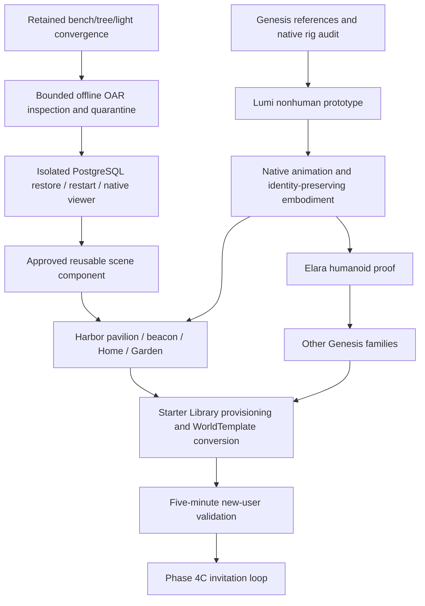

# Phase 4B integrated production ledger

2026-10-10. Plan reconciled with the supplied five-prompt integration brief. Finalverse is the consumer experience; MutSea is the spatial runtime/content authority; Studio is an authoring surface. This ledger records implemented evidence separately from proposed interfaces.

**Current status, 2026-10-12: OPEN.** The latest user instruction supersedes the historical closure/carry-forward decision. Genesis native compatibility is proven; full texture/face art, continuous LOD review, controlled performance and human/self-serve onboarding still gate acceptance. The roster stays at nine. Elara is exclusively female; Auren is the distinct male architect. Female Ignis uses garnet/gold/rose. [Current surface and region evidence](art/genesis-surface-validation-20261012.md).

## Starting state

| Component | Workspace below `~/Finalverse` | Starting commit | State |
|---|---|---|---|
| Viewer | `dev/worktrees/viewer-ai-world` | `378427a734` | `codex/phase4b-destinations-import`; destination/network/UI WIP preserved |
| MutSea | `dev/worktrees/mutsea-worldops` | `f3dcd7f1ee` | Same branch; clean |
| Studio | `studio` | `f47d4d2` | `main`; clean; no remote |
| AI gateway | `services/ai-gateway` | `4dc29c1` | Clean; unchanged |
| Agent runtime | `services/agent-runtime` | `1047793` | Clean; unchanged |

The older commit IDs in the brief are historical checkpoints. Current bench v0.1.8 front/side Sit/Stand acceptance, 10.4–10.6 s settled captures, native PBR/LOD/collision delivery and PostgreSQL restart evidence are retained in [the interaction record](art/bench-interaction-20261010.md). No new graphics benchmark is required for an offline archive tool. The [B1–B28 ledger](art/phase4b-gates-20261010.md) remains authoritative for completed visual gates.

At this pass's start Docker was stopped, the viewer was absent and the earlier blocked Blender process was absent. Starting Docker restores its configured services; unrelated services are not reconfigured. The retained Harbor data/config and earlier evidence are preserved.

## Dependency and delivery order

Tracks remain sequential until asset/compatibility contracts are proven. Scene Cloud hosting, WorldSync, commerce and enterprise are later work. An archive restore is an operator compatibility experiment, not an authorized WorldAction or an atomic WorldTemplate transaction.

## Existing contracts and proposed boundaries

Reuse `Finalverse/World/ContentKernel.cs`, `ContentModule.cs`, `ContentFingerprint.cs` and `tools/MutSea.Content/validate.py` for current small AssetPackages. They supply immutable catalog versions, hashes, semantics, policy, WorldLine, guarded Undo, native mesh/PBR/seats/LODs and bounded lights. Do not widen the static asset compiler's 32-part/4,096-triangle limit to accept avatars or whole buildings silently.

| Package | Current status | Boundary required before runtime publication |
|---|---|---|
| AssetPackage | Implemented bounded small assets | Existing validator/compiler/catalog; per-asset provenance |
| AvatarPackage | Proposed | Native skeleton/weights, appearance/inventory, animations, LODs, dependencies, permissions; completed templates only |
| OutfitPackage | Proposed | Native wearable/attachment compatibility, appearance save and observer delivery |
| PlaceTemplate | Proposed | Composition of validated assets with template-local entity IDs, semantics, spawn/navigation and ownership |
| WorldTemplate | Proposed | Terrain/environment/parcels, scene/semantic graphs, dependencies, permissions, compatibility/performance and instance-ID remap |
| ExperiencePackage | Proposed | Templates plus agents/workflows/policies; no arbitrary executable model output |

Separate source-archive digest, converter version, package version and instance ID. Reuse one content registry; do not introduce a second registry for OAR or nonhuman avatars. MutSea owns runtime identity/transforms/policy/WorldLine; Blender retains editable representations. The inspected native OAR loader resets runtime object UUIDs even in staging. Retain source UUIDs in provenance and verify an explicit source→runtime mapping; production provisioning still needs an authorized instance-ID allocator.

## OAR compatibility milestone

Read the fork's archiver, serializer, asset/terrain/parcels/settings and inventory loader. The native console restore starts scripts and can replace the scene. Validate raw archive bytes offline with finite compressed/decompressed/member/XML limits; reject traversal, links, malformed headers, unsupported inputs and duplicate identities. Produce a normalized script-free staging derivative and immutable audit report. Keep original bytes and license evidence outside Git. Disable the script engine throughout staging and restart; do not depend on region settings alone.

Use a fresh loopback-only simulator, separate PostgreSQL database and data/config storage, no Harbor mounts and no public grid route. Back up the empty instance before restore. Verify native object/asset/terrain/parcels/settings/ownership delivery, normal restart and one focused viewer capture. Dependency closure and whole-archive rights must be established before any production reuse or publication. See MutSea's `docs/mutsea/oar-compatibility.md` for exact experimental results.

**Implemented this increment:** OpenVCE 2022, passive derivative SHA-256 `30ed5f94444953eaf80fa2043b4a1f8994bdd518a6b7c674f78f93e4f966614b`. Separate PostgreSQL 16.14 staging received 459 groups / 4,090 parts and 283 passive assets. All source→runtime transforms/owners and stored asset hashes pass; 141 scripts, 50 nested inventory-object assets and 397 task inventories are excluded. All referenced nonzero texture UUIDs resolve; five largest native HTTP samples hash-match. Real login/region/UDP/assets/normal logout pass before and after clean simulator restart. Region scripts and both script engines remain disabled; task inventory stays empty. One real native Plaza Hub screenshot was reviewed. This is a legacy compatibility scene, not a finished Harbor template. Native mesh/PBR OAR, multiregion/IAR and whole-archive rights remain unproven.

The archive tool now has **26 passing tests**, including early XML node/depth limits, finite R32 heights, validated UUID filenames and equal-geometry link tie rejection. Viewer tooling has **32 passing tests**. A URI-only grid preflight defect was fixed: complete native `keyname`/agent/login-ID/non-system/single-fixture validation is required. The first incomplete profile reached the default login UI with native credentials cleared and autologin disabled; we quit before authentication, corrected it and passed the guarded launch. Historical B27 remains open. No C++ rebuild or broad graphics benchmark occurred.

## Genesis audit and production

The six supplied PNG references exist in `~/Project2026/Finalverse/Images`: Lumi, Kai Male/Female, Terra Male, Elara Female, Ignis Male. Their names differ from the brief's `.jpeg` names. They are design references; redistribution clearance is separate. Preserve exact hashes in the authoring manifest rather than copying operational paths into runtime packages.

Lumi is the mint-green companion with turquoise eyes and rounded triangular head. The earlier MPFB humanoid was an incompatible rig study, not this character design. Keep it as evidence. Establish a shared native skeleton/skin/animation/LOD contract, then a nonhuman Lumi representation and humanoid Elara Female proof. Preserve canonical Lumi citizen identity, memory, home, garden and WorldLine; migrate representation with recovery, without creating another citizen.

Order: Lumi → Elara Female → Auren → Kai Male/Female → Terra Male/Female → Ignis Male/Female. The provisional Elara Male identifier is retired; existing inventory is preserved and migration is explicit. Do not list incomplete models as selectable. Each accepted model needs real viewer idle/walk/turn/Sit where appropriate, appearance persistence, restart and a second observer. Native skin weights/rest pose and animation compatibility must be proven, not inferred from Blender renders.

Studio now pins all six actual PNG inputs and the native 133-bone / 26-volume skeleton in `manifests/genesis-reference-audit-v0.1.json`; **zero** production/selectable avatars. [Source audit and required representation boundary](art/genesis-native-pipeline.md). `CitizenBridge.Body()` currently returns a seven-part **SceneObjectGroup**, not an avatar ScenePresence; inherited avatar animations do not automatically animate it. A new representation adapter and recovery path must preserve the logical citizen ID. The static ContentCompile adapter explicitly supports only untextured/unrigged small assets, so it must not be silently reused for Genesis.

**Implemented 2026-10-10 (continuation): Lumi native animated embodiment.** An original Blender-independent Lumi package (12,020/3,956/1,328/470 triangles, 30 native joints, 7 factor-PBR materials) compiles through the new `MutSea.AvatarCompile`, verified by an independent viewer-equivalent decoder (8.4 µm rest-pose error). The citizen bridge migrates the canonical entity in place to a native animated object, journaled and snapshot-backed. Native viewer screenshots show stand and walk, identity verification passes, and PostgreSQL restart and exact rollback/re-apply pass. Native human gestures (`hello`) are delivered but hidden by Lumi's anatomy; Lumi-specific animations and Sit are next. Full gate table: [Genesis Lumi validation](art/genesis-lumi-validation.md).

**Implemented 2026-10-10/11: OpenVCE as a second Harbor region.** The passive OpenVCE derivative was loaded into a second region (`OpenVCE Plaza`) of the Harbor simulator, on the same PostgreSQL fixture. That simulator now hosts 4,090 OpenVCE parts beside Harbor. Native teleport takes 0.3 s each way. Before the load, a full `pg_dumpall` was taken, and the startup replay that would have hit both regions was disabled. Details are in MutSea `docs/mutsea/oar-compatibility.md`.

**Implemented 2026-10-11: Genesis humanoid family (v0.1.0).** Elara F/M, Kai F/M, Terra F/M and Ignis F/M are worn native avatars on the pinned CC0 MPFB base: a rigged attachment plus an alpha wearable. All eight compile and pass the independent decoder. All render natively, shown as a non-persistent animesh gallery on Harbor. Elara F is worn on a real account, seen by a second observer and rolled back. Walk/Sit while worn, LOD review, textures and the selectable chooser remain open. See [Genesis humanoid validation](art/genesis-humanoid-validation.md).

**Implemented 2026-10-11: PlaceTemplate and the Harbor Pavilion v2.** A place composes operator-approved small assets as pinned `package@version` placements with offsets and yaw. It adds place semantics and entrances, and is provisioned as one journaled operation: retire with snapshots, create every placement, compensate on failure, fingerprint-guarded rollback.

The pavilion replaced the v1 sandbox pavilion. It uses eight new modules plus the approved bench, lantern and tree (59 placements). Native walk / Sit / Stand passes, agent semantics carry the place context, and rollback and re-provision were rehearsed live. See [Harbor Pavilion validation](art/harbor-pavilion-validation.md). The beacon, arrival, Lumi Home, Garden and waterfront follow the same path.

**Implemented 2026-10-11: Arrival, Beacon, Lake Overlook, Lumi's cottage.**

- **Harbor Arrival** (70 placements) with the stacked **Harbor Beacon**.
- **Lake Overlook** (29 placements, approved modules only).
- **Lumi's Cottage Garden** (9 placements) around her identity-preserving home, which was restyled through three undoable WorldPlans.

Lumi still walks home from every side and plants and undoes her own garden. A navigation obstacle-model defect found by these checks was fixed: snapshots now report a body-height footprint. See [hero places](art/harbor-hero-places-validation.md).

**Implemented 2026-10-11: walks, the first WorldTemplate and the lighting review.**

- North and Lake walks replace the v1 path slabs.
- `mutsea.starter.harbor-world@0.2.0` composes the arrival, pavilion, overlook and walks on Harbor's terrain. It was provisioned into a fresh region, visited by a second account, rolled back and re-provisioned.
- Eight-camera native sets were captured in Day, Golden Hour and Night.
- A disk-full incident, caused by recreating the simulator container without `-it`, is recorded with its mitigation.

See [world template, lighting and incident](art/harbor-world-template-validation.md).

**Implemented 2026-10-11: newcomer provisioning and the five-minute entry check.**

- MutSea `[FinalverseAccounts]` prepares local accounts with a chosen Genesis outfit and the arrival as home.
- A new account (Kai Female) made a cold-cache first native login onto the arrival compass, and a second account saw its Genesis appearance.
- Its protocol journey covered place semantics, the starter world, the walk to the pavilion and a bench sit/stand: 9 milestones in 31.1 s.
- It resumed at the pavilion on re-login, with a native sit and stand.
- Human-session, chooser and visitor-to-Lumi checks remain.

See [onboarding](art/newcomer-onboarding-validation.md).

Historical note: a fresh Mac Blender process blocked in mounted-volume enumeration before Python. After a 2026-10-10 reboot with the exFAT drive `HPP900` no longer mounted, Blender 5.2.2 started normally, which supports the FSKit-volume diagnosis; the reboot also reset state, so it is not proven. A separate pinned Debian ARM64 headless authoring build was attempted; dependency downloads failed on HTTP connections to the official Debian mirror. It has not generated a character. No volume was detached, no Blender preferences were changed and no fresh authoring success is claimed.

## Visual and performance acceptance

Finish continuous collision/navigation, conservative Balanced profile, Golden Hour foreground fill and Night destination lighting, then hero pavilion/beacon/arrival/Home/Garden/waterfront composition. Use retained single-camera queue for iteration; three views at feature milestones; eight views and controlled frame-time comparison only for release. Keep renderer and product defaults until measured evidence supports changes.

Current small assets retain their actual budgets: bench 1,404/754/286/130 triangles, tree 1,280/704/278/128, lantern 224/120/44/22; two or three materials, no texture payloads. Avatar and place budgets must be measured after the first native pipeline proof. Record triangles, draw/material count, texture/animation memory, download bytes, collision and LOD transitions. Factor-only PBR is not textured hero-quality content.

## Release gates

Production Lumi/native motions; recognizable and walkable hero areas; accepted Golden Hour/Night; stable appearance and identity; grounded AI semantics; guarded operations/Undo; PostgreSQL restart; package provenance/dependency closure; original Harbor IDs retained; native viewer evidence and acceptable frame-time percentiles; completed regression suite. The nine-template collection passes native compatibility checks and the WorldTemplate lifecycle passes on the current fixture; this does not accept final avatar art or every release gate. New-user validation passes on the machine path; a human session, a self-serve chooser and visitor-to-Lumi interaction remain open. Commit coherent milestones locally; no push or remote deployment is authorized by this brief.
