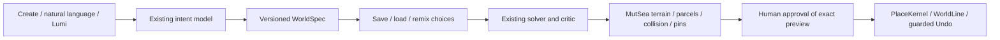

# World Architect: recipes, grounded placement and Lumi co-building — 2026-10-13

Implemented as one bounded place, using the inherited viewer and existing MutSea executor. Final avatar/environment art, self-serve avatar onboarding and controlled release performance remain open. This is a local development milestone, not public production acceptance.

## Authoring contract

Gateway `composer/world_spec.py` reuses PlaceIntent. WorldSpec1 retains its original exact forward-placement behavior. WorldSpec2 additionally requires a bounded `site`: `in_front_of_actor`, `near_actor` or `near_water`. Solver version and catalog hash remain pinned. Unknown keys, versions and incompatible catalogs reject. Recipes carry authoring choices, with no actor credentials, entity IDs, coordinates, asset URLs or executable code. Canonical JSON and SHA-256 make edits diffable; these are not whole-world branches or merge operations.

Natural composition emits v2: ordinary requests choose nearby clear ground, while lake/water/shore requests select the water rule. `POST /v1/world/spec/plan` compiles a recipe without inference. The existing offline `python -m composer.world_spec recipe.json NEW-preview.json` remains available. Changing a v1 recipe's placement in the viewer explicitly produces v2 rather than silently changing old behavior.

## Mac Create UI

**Create → Load a recipe** uses the mature asynchronous native file picker. Finalverse AI exposes Load, Save and Remix. Remix copies the recipe and edits name, bench count, size, planting, lighting and placement; its button produces a new preview, never an automatic commit. Saving keeps the current preview. The original file remains unchanged. Files are bounded to 4096 bytes and must be regular/non-symlink inputs; exclusive mode-0600 output creation refuses overwriting an existing file. The gateway checks exact pins again.

The AI panel retains its recipe and last-operation handle when hidden. **Nearby** recovers the latest owned Undo handle from the server after a viewer restart. **History** joins the existing action and place journals into bounded human summaries, without introducing another database or executor. Closing/reopening invalidates an approval preview through the existing entry flow; it does not discard a completed operation's Undo handle. A simulator restart invalidates pending approval, as before.

## Grounded siting

`ComposerSiting.cs` evaluates at most32 candidates within64 meters. It samples actual region height/water data, checks nine footprint samples for dry level terrain and retains the existing PlaceKernel's object/parcel/permission checks for every actual part. The water rule requires real submerged terrain within12 meters; an arbitrary label or decorative water mesh does not satisfy it. If no valid site exists, the request refuses without mutation.

Prepare returns the exact anchor/yaw/rationale and actual native part count. Commit rechecks the approved terrain/shoreline and uses the same place plan. It never moves a proposal silently after approval. Legacy recipes retain one exact forward candidate. Native nearby placement passed; a real native shoreline creation remains an open integration gate. Synthetic wet/dry/steep/edge/change tests are not relabelled as native shoreline proof.

## Lumi co-builder

**Create → Create with Lumi** pre-fills a request and waits for Send. Existing Rust runtime routes a creation intention to the existing gateway and permits only a single bounded compose_place proposal. MutSea's tokenized citizen bridge wraps the same prepare/commit/Undo paths and ownership checks. Lumi cannot execute model code or arbitrary WorldActions.

The controller reviews a grounded preview and explicitly chooses **Build together**. One goal has a192-part/180-second budget, two model calls maximum and the retained action budget. Charge actual parts, not placement-group count. Only a matching confirmed commit completes the goal and writes episodic memory; late cancelled replies and failed commits are blocked. Goal/intention/action/plan/operation IDs remain correlated. Completed memory and server citizen plan ownership restore from the existing SQLite/journals. The service remains controller-only; newly registered users cannot independently command this shared Lumi.

A co-built recipe can be saved through the same native picker and later loaded/remixed. A dedicated conversational remix of an existing place and persistent recipe library in the agent database are not implemented. After runtime restart the saved file remains available, while volatile authoring/preview state is cleared.

## Validation

- Gateway:70 tests, including v1 compatibility, v2 choice/pin validation, canonical identity and inference-free HTTP replay.
- Rust:69 tests, including retained43 persistence tests and26 runtime tests. New tests cover cancellation, approval gating, actual part budgets, confirmed commit/Undo memory and failed-commit refusal.
- MutSea:10 siting/audit checks plus45 retained content/place/world-template checks. World add-on builds with zero warnings/errors. Native smoke has one retained nullable warning in the older compose branch.
- ARM64 Release viewer builds; recipe TUT and presentation CTests pass. Four recipe cases cover exclusive saves, immutability, bounded inputs and v1/v2 handling. Final packaged XML contrast and controls were checked natively.
- Native Save/Remix: original recipe preserved; three-bench remix built12 placements/116 parts, visibly rendered, survived simulator restart, recovered Undo through Nearby and rolled back. History shows commit/Undo.
- Native Lumi: one local Ollama inference (22.77 seconds) proposed7 placements/29 parts. Preview preceded creation; explicit Build together confirmed the mutation and goal memory. Native scene rendered one bench/paving/two lights. Saved recipe equals the proposed authoring data. Replay and remix require no further model calls.

After both services restarted, the read-only native probe verified all29 part IDs/transforms and owned place semantics, the completed goal/memory and Human WorldLine. The native viewer then invoked Undo; the place journal confirmed rollback and a read-only PostgreSQL query found zero of its29 part IDs. The saved recipe persisted. A newer approved creation was preserved. The optional `co_build_undo_verify` UDP mode is implemented but not executed in this increment; database absence is not mislabelled as a post-Undo UDP test.

Private receipts are under `dev/worldspec-create-20261013`; no credentials, raw journals, database dumps or screenshots are committed. Follow its validation/handoff record for restart and full-part protocol acceptance. The older `dev/phase4b/closeout-20261013/worldspec-native-{build,undo}.json` proves the earlier newcomer CLI route (nine placements/81 parts) and remains retained.

## Next bounded gate

Advance one script-disabled Tropical OAR into an isolated staging instance, retaining Harbor and its PostgreSQL volumes. Verify terrain, dependency closure, native delivery, spawn/collision and provenance before turning it into a reusable WorldTemplate. Do not publish an archive merely because the catalog says CC0. No additional characters, renderer rewrite or speculative enterprise backend is needed for this slice.
