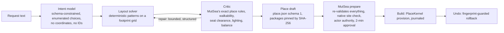

# R&D: AI Place Composer

2026-10-12 baseline, updated2026-10-13. The historical [Phase4B checkpoint](../phase4b-closure-20261012.md) is superseded by current release gates. The latest user instruction prioritizes bounded engineering convergence and innovative creation features together.

**Goal:** a person describes a place ("a reading nook by the lake", "a picnic spot for six"). Lumi composes it from the approved Starter Library. The person reviews the validated preview, builds it, and can undo it in one step. It should be good enough to demo and to ship, not a toy.

## Principle: the model proposes intent; deterministic systems lay it out and validate it

Small local models produce coordinates poorly but choose among named options well. The composer therefore splits the work:

The model never emits coordinates, package versions, hashes or entity IDs. The solver output is still untrusted: MutSea validates every draft exactly as it validates an operator place. The draft's summary text is generated from the validated placements, not by the model, so the preview cannot describe something that will not be built.

## Contracts

- **PlaceIntent** (model output, JSON schema), all fields enumerated or bounded:
  - title (≤ 60 characters) and a one-line purpose;
  - archetype: nook, picnic, circle, garden, lookout, plaza, grove, pavilion;
  - size: small, medium or large;
  - ground: grass, paved or deck;
  - seating count and arrangement;
  - lighting, planting, shade, focal feature and edge treatment;
  - an open side that sets the entrance and view.
- **Layout solver:** archetype patterns placed on a 0.25 m footprint grid. It uses the real package footprints (MutSea's radius rule) and keeps clearance zones in front of every seat and along an entrance path. Seats face the focal feature (yaw = bearing + 90°, since a sitter faces the bench's local −Y). It is seeded from the request, so the same request gives the same place.
- **Critic:**
  - **Hard checks:** MutSea's place rules (≤ 96 placements, ≤ 65,536 triangles, ≤ 12 lights, footprints inside the bounds, offsets and heights in range); no footprint overlaps; every seat reachable on foot from the entrance; every requested feature realized.
  - **Soft scores:** seats facing the focus, lighting coverage of seats and paths, balance and density.
- **PlaceDraft:** `place.json`, as authored by Studio's place builder. The place ID is `user.<actor>.<slug>` with a timestamp version. Its provenance records the model, the intent and the solver version.
- **MutSea integration:** a `compose_place` World-plan action. `prepare` returns the usual steps, one per placement, so the existing Create panel shows it without a viewer rebuild. `commit` provisions through PlaceKernel as the actor. `undo` rolls it back.

## Milestones and acceptance

| Milestone | Scope | Acceptance |
|---|---|---|
| **M1 Engine** | Intent schema, solver, critic, draft writer; a fixed 20-prompt evaluation set | 100% of solved drafts pass the hard checks offline. Feature satisfaction ≥ 90% from gold intents. Report intent validity and latency per local model |
| **M2 Runtime** | `compose_place` in MutSea (prepare/commit/undo, actor authority, site check, journal) and the gateway endpoint | Native-viewer build and undo of three compositions, with a second-observer check, PostgreSQL restart and semantics through the World relay |
| **M3 Quality** | A model bake-off (llama3.2 3B, granite3.1-moe 3B, qwen2.5-coder 3B, gemma4) and a pattern expansion (pergola, terrace, lantern walk) | Native screenshots reviewed for each archetype. Median end-to-end time ≤ 10 s on this Mac |
| **M4 Lumi** | "Lumi, build …" through the citizen; Lumi describes what she built | The human approval gate is unchanged; grounded answers about the composed place |

## Out of scope for this track

- New asset geometry. The composer uses the approved library; the visual-quality track adds assets.
- Retiring or moving existing objects. A composition goes only into free space, refused if anything intrudes.
- Public deployment, cloud inference, and accepting compositions from untrusted clients without the MutSea checks.

## Results, 2026-10-12 (M1 and M2)

Commits are local only:
- gateway `0a720d9`: the composer, the route and 58 offline tests;
- MutSea `7496b738c7`: ComposerBridge, `PlaceKernel.PlanDraft`, probes, and 45 content tests.

Evidence is in `dev/rd/composer-20261012/`.

### M1 — engine: PASS

| Measure | Result |
|---|---|
| Default intents (8 archetypes × 3 sizes) | 24/24 pass the hard checks; quality 86–100 |
| Random valid intents (3,000) | **100% buildable**, 82% exactly as asked; every change reported; about 12 ms per composition |
| Tuning prompts (20) | llama3.2 3B and qwen2.5-coder 3B: 20/20 understood; granite3.1-moe 3B 15/20 |
| **Held-out prompts (20, never tuned on)** | llama3.2 3B **15/20 (fields 90.7%)**, qwen2.5-coder 3B 15/20 (88.9%), granite3.1-moe 3B 10/20 (77.8%). All outputs buildable |
| gemma4 8B, deepseek-r1 8B | No schema-valid output in this Ollama setup (prose or code fences around JSON, or timeouts) |

What moved quality most:
- **Code, not the model, computes.** Seat radius comes from the focal piece's footprint; the platform grows to fit the seats; deck width comes from the bench row.
- **The model extracts, code calculates.** Numbers in the request are read deterministically: field accuracy rose from 87% to 98% on the tuning set.
- **Bounded, reported repairs** instead of silent substitutions.

### M2 — runtime: PASS on the protocol path

On Harbor, the account "Harbor Newcomer" (a newcomer, not the estate owner) asked for three places, each through the gateway and the World relay `prepare` / `commit`:

- *"Build a cozy reading nook under a tree"*: 17 placements.
- *"Build a small lookout deck with three benches in a row"*: 40 placements.
- *"Make a picnic spot for six people"*: 10 placements. "Six people" became three benches.

Each was sited in front of the newcomer under their own parcel rights. Preparing took 0.18–0.26 s. Building took 0.9, 4.3 and 0.4 s.

- **Second observer (native).** FirstLook's viewer rendered all three (`sheet-composed-native-v1.png`).
- **Semantics.** The World relay identifies the composed parts as the newcomer's place `user.36210212.*`.
- **Refusal.** A site overlapping an existing object was refused by name, and nothing was written.
- **Restart.** All 67 groups / 405 parts persisted across a simulator restart.
- **Undo after restart.** All three were undone by their builder: object stream 1253 → 848, matching the count before the first build; owner parts 0; journal `rolled_back`.

The Create panel UI itself was not driven; the probe uses the same relay operations it does.

### Findings that shape M3

- **Local inference shares the player's GPU.** llama3.2 3B takes 4.7–5.8 s with the viewer closed and about 13.7 s while it renders. A market-quality build should run inference on the gateway host, not the player's machine. The ≤ 10 s goal holds only off the client GPU.
- **Held-out misses are general language, not prompt quirks:**
  - "family of ten" and "no benches" are not read as numbers;
  - "full of lanterns" should mean high lighting;
  - "bordered with flower beds" should mean an edge;
  - "a circle under a roof" became a pavilion.

  Fixes must be measured on a new held-out set.
- **Visual quality.**
  - A small nook gets 8 m paving for one bench.
  - Titles are bland ("Nook").
  - A requested canopy is dropped in about 13% of random intents. It cannot stand over a beacon, and on large paved places a roof exceeds the 96-placement budget.
- **Not yet built:** a terrain-aware site search ("put it by the lake"), and Lumi as co-builder (M4).

### WorldSpec vertical slice (2026-10-13)

Saved, version/catalog-pinned place recipes now replay through the same solver/critic and MutSea WorldPlan path without inference. A real newcomer built a nine-placement recipe, received place semantics, then restored the848-part fixture through guarded Undo. Gateway91ms, prepare497ms, commit981ms. A natural-language request also exported a recipe; replay34.27ms and a three-bench remix17.08ms required no more model calls. These are feature measurements, not a human five-minute journey or a new release-performance gate. [Implementation and exact limitations](../phase4b/world-architect-prototype.md).
