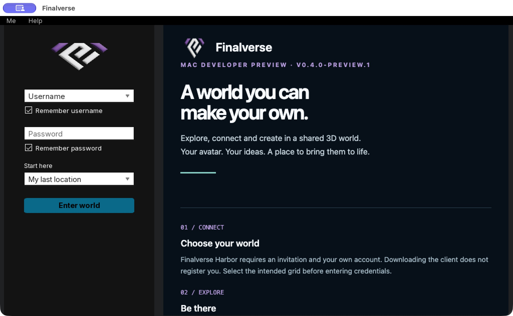

# Mac developer-preview delivery — October 16, 2026

> Postrelease finding: this original acceptance covered writable installed
> copies and a read-only APFS disk image. It missed macOS AppTranslocation's
> distinct read-only nullfs behavior. A real user installation exposed an
> inherited `O_CREAT` input-read defect. [Preview.2 acceptance](0.4.0-preview.2-acceptance.md)
> records the reproduced failure, shared-reader fix and replacement package.
> The historical checks below do not certify preview.1 in that protected mount.

The [GitHub prerelease](https://github.com/finalverse/final_viewer/releases/tag/v0.4.0-preview.1)
is public. Installer and demo MP4 downloads are served by GitHub Releases.

- Source tag: `v0.4.0-preview.1`, commit `2abd4a0e01732d8b7631dce84b6d65da937f2f3a`.
- Installer: `Finalverse-0.4.0-preview.1-mac-universal.dmg`, 417,026,137 bytes.
- SHA-256: `d15cb1c39120ebdc8af16336585fd066612d52c1c49abc50de15412cb20ed176`.
- Universal build and all **119 CTest tests passed**.
- Staged, read-only-mounted and installed copies passed deep/strict ad hoc
  signature verification. Architectures, bundle symlinks, dynamic-library paths,
  private/debug files, empty login defaults and source archive were checked.
- The installed copy launched with an isolated fresh profile on Apple Silicon.
  Bundled skins and graphics initialized; the pinned Finalverse grid was selected;
  it reached the login wait state with no ERROR/FATAL records.
- After unlocking the Mac, the exact installed copy visibly showed the preview
  welcome/version, blank username/password and invitation instructions. The
  normal Quit confirmation and process exit passed. No account was entered.
- A complete anonymous GitHub download matched the installer SHA-256. Source,
  dependency-source, checksum and video URLs support anonymous range downloads.
- The 20-second captioned **still-image recap** played in the browser without
  media errors. Its two authentic captures show the previously accepted hosted
  creation/Undo; native counts were 423 → 570 → 423. It is not continuous footage.
- Public website checks passed for nine current pages, HTTPS, redirects, security
  headers, native screenshots, CSS, captions, true 404s and exclusion of operator
  context. Public grid admission remained closed with the same 503 response.

The initial release verification JSON records the Mac lock at publication. The
additive postrelease verification JSON and fresh-login PNG close that visual
check; the installer and source archives did not change.

This accepts an **experimental developer preview**, not a signed/notarized beta
or GA product. Developer ID/notarization, second-Mac and Intel acceptance, public
onboarding, multi-user citizen ownership and broader load/device gates remain
open. Optional libVLC/codec playback is excluded; voice defaults off. This fresh
package check does not claim another world-entry session or expand the earlier
private controller acceptance.

See [getting started](../getting-started.md), [build/source inputs](../building-preview.md),
[release scope](0.4.0-preview.1.md) and [hosted acceptance](../hosted-lumi-and-placement.md).
