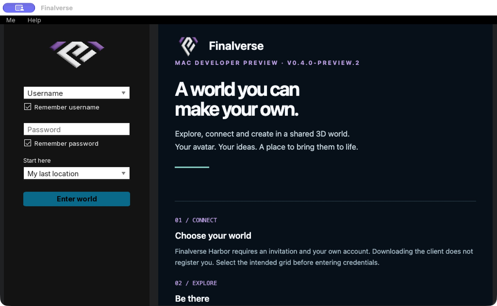

# Mac startup hotfix acceptance — October 16, 2026

- Release: `v0.4.0-preview.2`, engine `26.4.0.54622`.
- Packaged source: `1978115debd8376d89c3ebabbe8e530c5c5cca80`.
- Installer: `Finalverse-0.4.0-preview.2-mac-universal.dmg`, **438,369,817 bytes**.
- SHA-256: `62ed5e997454b345762922dc2e553b5c8bad347128fa4706527044dfb65e15f9`.

## Failure reproduced and repaired

The reported preview.1 DMG matched its published checksum. Its required settings
were present. On the actual protected AppTranslocation mount, ordinary read-only
opens succeeded but input opens requesting `O_CREAT` failed with EROFS. The
inherited POSIX `LLFile` reader requested that flag for every open.

The native probe linked to that reader failed to read all eight startup resources
before the fix and read all eight successfully after rebuilding it, against the
same mount. The added missing-input unit test also failed before the fix and
passed afterward. Output creation tests remain green. This addresses a reader
defect; resetting a profile or copying in another settings file is unnecessary.

## Build, package and installed execution

- The universal viewer and test builds passed. All **119 CTest checks passed**,
  including the six-case LLFile suite; CTest elapsed time was 83.38 seconds.
- Native tests ran from code-fix commit `91b960d3b4508f37e925fe6997435a0d0011f6ec`.
  The packaged commit adds only the welcome version correction and packaging
  validation; its resource refresh required zero C++ compilation steps.
- The packager verified required XML, native reads and resource hashes, bundle
  symlinks and dynamic links, private/debug-file exclusions, empty login defaults,
  universal architectures and the deep/strict ad hoc signature.
- It mounted the exact DMG read-only, repeated the native resource/signature checks
  and compared startup and welcome-page hashes with staging. This supplements the
  separate AppTranslocation reproduction; APFS and nullfs are different cases.
- The app was copied from that DMG to Applications. Its executable and welcome
  hashes matched provenance. All eight installed resource reads and its signature
  passed. The installer was ejected before execution.
- With an isolated fresh Cocoa profile on Apple Silicon, bundled skin/welcome and
  graphics initialized, the default grid was `grid.mutsea.com`, and startup reached
  `STATE_LOGIN_WAIT` without ERROR/FATAL records or the missing-configuration error.
- Native visual review showed the **preview.2** welcome, empty credential fields
  and no missing-files dialog. Normal Quit confirmation and process exit passed.
  No account was entered, and the existing user profile was preserved.
- The 9,793-entry viewer source archive passed the operator-file exclusion scan.
  Corresponding dependency sources are unchanged from preview.1 and retain the
  same pinned archive hash. Public artifacts carry checksums and provenance.

## Scope

This accepts the startup hotfix and experimental Mac package. It does not claim
a new world-entry/AI mutation session, Intel or second-Mac runtime acceptance,
public onboarding, wider load/device certification, Developer ID signing or
notarization. The hosted-Lumi media is the existing authentic still-image recap.
The separate Gatekeeper signing limitation remains documented in
[getting started](../getting-started.md).
