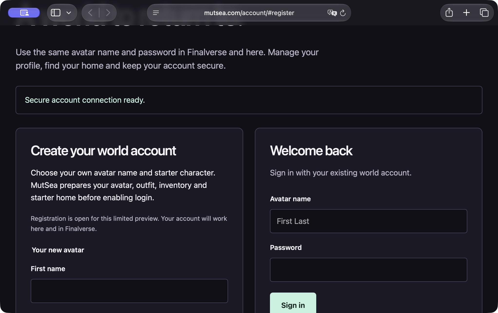

# Finalverse 0.4.0-preview.3 — real world accounts

This experimental Mac universal preview connects the login screen to MutSea's
real registration and account-recovery portal. It retains preview.2's protected
macOS resource-read fix. It is ad hoc signed, not Developer ID signed/notarized.

- The grid selector stays visible, including saved Second Life selections.
  Credentials are never silently moved from an existing grid to another.
- Sign up on the MutSea grid opens `https://mutsea.com/account/#register`;
  password help opens its recovery page. Other grids retain their own account flow.
- A MutSea login requires **First Last**. A UUID/email is rejected locally with
  a clear explanation before sending a request.
- The welcome page and [getting-started guide](../getting-started.md) explain
  registration, avatar/home provisioning, recovery codes and grid selection.

The separately hosted native MutSea service provisions ordinary identities,
owned starter wearables, Genesis alpha/mesh attachments, current-outfit links
and a persistent home before enabling login. It uses the existing .NET 8 services
and PostgreSQL, with a bounded encrypted queue, readiness checks and capacity
limits. No AI provider receives registration passwords.

A real newly registered synthetic account passed external native TLS login,
UDP scene streaming, HTTPS capability negotiation and logout. The portal accepted
the same credential and showed the provisioned home. An isolated running native
world verified activation, appearance/inventory ownership and restart persistence.
See [server contract and limits](https://github.com/finalverse/mutsea-o/blob/main/docs/mutsea/registration.md).

The universal viewer rebuilt successfully and all **119 CTest tests passed**.
Package-specific signatures, native resource reads and mounted DMG verification
are supplied in the release's verification artifact. The exact installed DMG launched with a visible grid picker and preview.3 welcome.
Interactive native checks then confirmed invalid-name guidance, Sign up opening
the live HTTPS registration page in Safari, and normal Quit/process exit. The
release includes a UI acceptance addendum; it clears the initial screen-lock
limitation without replacing the published installer. A complete anonymous GitHub
download matched its full byte size and SHA-256.

Registration is a limited preview, not a GA hosting launch. Email is unverified;
email reset and MFA are unavailable. Save recovery codes privately. Native legacy
password storage and the current 16-character viewer limit remain pre-GA security
work. Intel hardware, Windows/Linux binaries, cross-device performance and general
multi-user Lumi control are not certified by this release. Optional libVLC/codec
playback remains excluded and voice defaults off.

Download the DMG and SHA256SUMS from the GitHub release Assets. Source, dependency
source and build/dependency provenance accompany it. No operator config, account
password, token, database dump or cloud key belongs in these assets.

