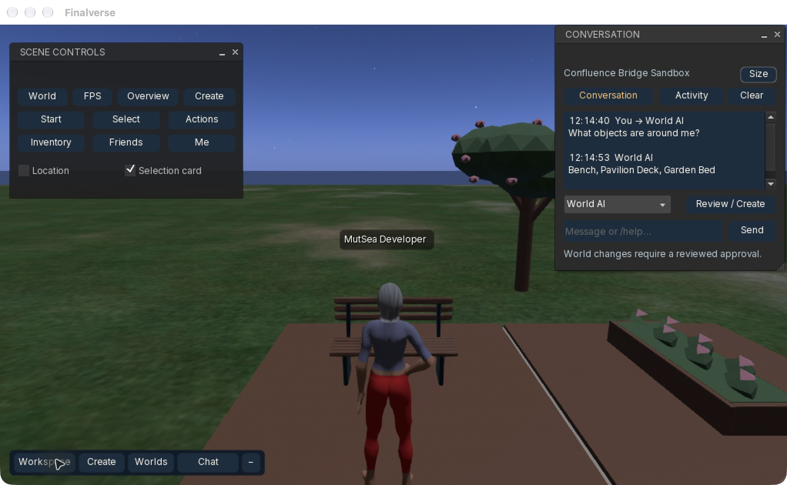
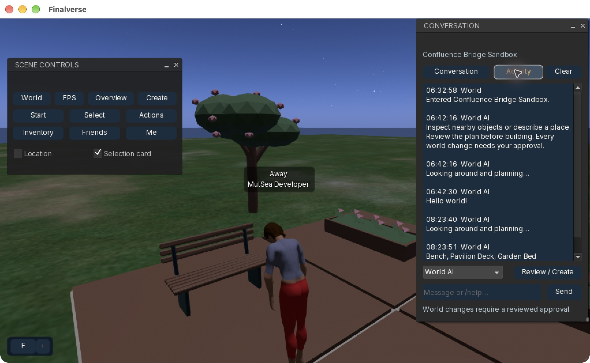

# Scene workspace and conversation

The scene keeps a 332 × 34 logical-pixel launcher and an optional 224 × 26
location chip. The former three-button utility strip, 304 × 80 identity card,
332 × 44 view strip and 620 × 104 command surface have been replaced. The
launcher collapses to 80 pixels. Existing selection, avatar and native editing
permissions remain authoritative.

## Controls

- **Workspace** toggles a movable, minimizable scene-control palette. World, FPS,
  Overview, Create, Select and action search reuse the existing native tools.
- **Location** and **Selection card** checkboxes hide optional scene overlays.
- **Chat** toggles the independent conversation window; a dot marks new activity.
- **Finalverse → Scene controls** (`Ctrl+Alt+Space`) and **Conversation / Activity**
  (`Ctrl+Alt+C`) restore closed windows without menu hunting.
- Existing creation, recipe, AI and Earth review windows retain their positions
  and can minimize. The conversation window also resizes; **Size** switches between compact (320)
  and expanded (420) logical-pixel heights without dragging a corner.

## Conversation

Choose **World AI**, **Lumi**, or **Nearby · public** before sending. Nearby uses
the inherited native chat path. World AI and Lumi use the existing planning or
controller relay; no new provider, model secret or agent identity is added.
Lumi remains unavailable outside her authorized interactive region. Read-only
questions and AI answers stay in a transcript instead of replacing the previous
reply. **Review / Create** opens the existing exact-proposal approval panel.
Chat never automatically approves a world mutation.

The **Activity** view shows actual region arrivals, filtered nearby object/system
messages, non-IM tip notifications, AI progress and authoritative Earth–World
status/receipts. It does not expose private IMs, muted chat, hidden script errors,
notification payloads, capability URLs or raw HTTP logs. Native notifications
retain their original actionable buttons and approval behavior.

## Privacy and performance

This display is memory-only and scoped to the current native login. A new login
clears the prior transcript. It holds at most 128 messages / 64 KiB of message
text, truncates on UTF-8 boundaries and strips terminal control bytes. **Clear**
clears this display, not server history. The display is never automatically sent
as model context. Its append path only buffers data; UI text layout runs on the
main viewer coroutine. There is no new background model or network poll.

## Verification

The presentation tests cover login isolation, bounded retention, rejected stream
types and UTF-8/control-byte handling. The macOS Apple Silicon build and all 119 CTest projects passed on 2026-10-21.
The presentation target includes 17 tests; the login-grid target includes 12.
The final one-click sizing change rebuilt successfully and the presentation
target passed again.

Actual native checks in the isolated Confluence region covered:

- A real local model answered “What objects are around me?” with “Bench,
  Pavilion Deck, Garden Bed” in approximately 11 seconds (one warm sample,
  not a latency percentile).
- Native Nearby chat was delivered and mirrored into the conversation display.
- Activity showed actual region arrival and AI progress/results.
- The scene-control palette moved; location hiding and dock collapse/expansion
  worked. The conversation opened with Ctrl+Alt+C.
- Tabs stayed aligned and the composer remained usable at compact and expanded
  heights and at native window widths of 1628 and 2044 physical pixels.
- Saved panel geometry and overlay preferences survived a test-app restart; the
  prior session transcript correctly disappeared.

Automated corner dragging did not produce a confirmed manual resize; it is not
counted as a passed interaction. The Size button exercised actual native
reshaping with no overlapping controls. Broader accessibility, display-scale
and non-macOS native checks remain unverified. Hosted Lumi is not claimed as
verified by this local model check.

