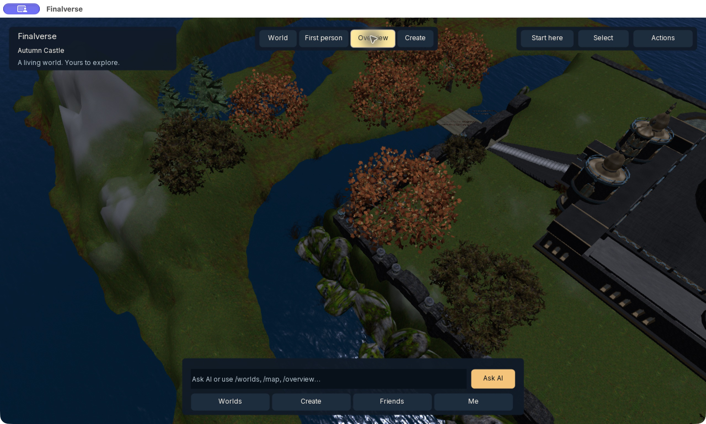

# Direct views and actions — developer preview

This UI increment reduces nested navigation with four persistent view controls, a searchable Actions surface and direct access to Worlds and Friends. It reuses native camera, object selection, inventory and action callbacks. Changing a view does not move an avatar, grant permissions or mutate the world.

| View | Immediate behavior | Useful for |
|---|---|---|
| World | Native third-person camera following your avatar | Walking, social presence, exploration |
| First person | Native mouselook; heavy facade panels hidden | Immersion and direct spatial interaction |
| Overview | Elevated, oblique view of the local area; normal orbit/zoom remain available | Understanding layout and nearby places |
| Create | Focus the selected object, or nearby ground, and open creation choices | Object work and reviewed AI creation |

**World** restores the familiar avatar camera. Native Escape/camera controls leave mouselook. Overview is a local-area camera preset, not a world map, drone simulation or permission bypass. It does not increase draw distance or change the renderer. Camera constraints and restrictions remain native.

## Actions without menu hunting

**Worlds** in the bottom dock opens the native World Library directly. **Friends** opens the native Friends tab directly. **Actions** opens a compact, searchable list of sixteen existing tools: type “wardrobe”, “lighting”, “inventory” or “map”, then press Return. All search words must match; matching includes familiar synonyms. Double-clicking a result or choosing **Open action** also works. Existing enabled callbacks and permissions still decide availability. Unknown text cannot become a command.

HUD actions bind once. The selected-object AI callback reads the current selection when clicked, instead of accumulating callbacks during periodic refresh.

The palette runs locally without a model call. It has a visible Full interface escape hatch, retains the existing keyboard bindings and does not change world state merely by searching.

Selected objects expose **Focus**, **Ask AI** and **Edit** directly. Focus uses the existing native selection framing; Edit uses the inherited build tool and its permission checks. The model is not invoked just to change the camera or open inventory.

| Frequent task | Previous facade route | New route |
|---|---|---|
| Visit a region | Explore → discovery/library | Worlds |
| Open Friends | Friends → Friends list | Friends |
| Change camera viewpoint | Tools/full interface → camera controls | World / First person / Overview |
| Find inventory, appearance or lighting tools | Locate the relevant page/menu | Actions → type → Return |
| Frame an object | Open camera/tool menus after selecting | Select object → Focus |

## Keyboard-first local actions

Type a command in the bottom AI bar and press Return:

| Command | Opens or selects |
|---|---|
| `/world` | World view |
| `/fps` | First-person view |
| `/overview`, `/bird` | Overview |
| `/create` | Create view |
| `/worlds` | World Library |
| `/map` | Native World Map |
| `/inventory` | Native inventory |
| `/friends` | Native Friends tab |
| `/me` | Native profile |
| `/help` | Actions and full-interface access |

Only explicit allowlisted slash commands run locally. Ordinary text still goes through the existing AI proposal/review path. Unknown slash commands show Actions help and are never forwarded as arbitrary tool or registry calls. This saves model cost and avoids treating simple navigation as an AI transaction.

The view strip sits between identity and utility controls on wider windows and moves below them on compact windows. Existing menus remain available through **Actions → Full interface**; power users keep the mature tool surface.

## Direction: task-oriented spatial workspaces

The inherited interface is organized around subsystems. People usually arrive with a goal: visit a place, meet someone, create something, or understand a change. Keep the mature tools behind a thin interaction layer organized around those goals. Do not add a permanent toolbar button for every feature.

| Proposed workspace | Purpose | Next requirement |
|---|---|---|
| Confluence conversation | Focus on a person/agent, with a readable conversation and shared references beside the scene | Explicit participant/session consent, thread persistence and access checks |
| World architect | Use Overview with a selected area, semantic labels and an approved placement preview | Grounded area selection, placement constraints and native permission-aware affordances |
| Agent activity | See participants, current tasks and proposed actions spatially | Real agent/task events, cancel controls and bounded delegation |
| WorldLine review | Compare a proposed change, approve it and inspect supported Undo | Spatial before/after overlays tied to canonical transaction IDs |

These workspaces are a design direction; the current increment implements the four views, action search and object Focus. Confluence currently supplies zone context to the existing planner. Private conversations, agent task graphs and spatial before/after overlays are separate implementation work.

Usability goals for subsequent increments: open a frequent tool in one dock click or Actions plus a search; retain Escape to leave immersion; expose the selected entity and permission reason; preserve text scaling and keyboard focus; keep camera/navigation independent of model latency. Measure actual task completion and HUD cost before adding more chrome.

## Verification and release status — 2026-10-18

The universal Release viewer and the separate presentation-test target built successfully. Fourteen focused cases pass, covering session-bound destinations, command allowlisting, semantic action search and bounded teleport-source deferral. Four changed XUI files parse successfully. Earlier unchanged CTest entries were run under RelWithDebInfo; this is not a claim that every test target was rebuilt under Release.

Native Apple Silicon checks exercised Overview, First person and Escape, Create, `/worlds`, action filtering and Return to the inherited Inventory, and the Worlds dock button. The combined run displayed all five live destinations, teleported from Autumn Castle to Confluence, remained connected there for over eight minutes, returned to Harbor, and quit normally. The directory remained usable after arrival.

The screenshot is an actual native rendering of the CC0 Autumn Castle sample by Linda Kellie Henson / Zadaroo contributors. It is UI evidence, not a premium-art quality claim.

A separate delayed UDP disconnect occurred during an earlier multi-region session. Lasting native connectivity remains under investigation; the published preview.3 download has not been replaced by this source build. A new installer requires resolution or a bounded, documented acceptance result plus fresh-package checks.
