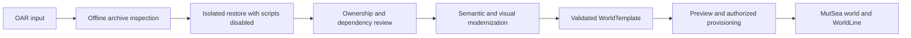

# OAR input and MutSea WorldTemplate conversion

2026-10-09. This is a future import plan, not a deployed Scene Cloud feature. Harbor remains intentionally authored. No arbitrary OAR is restored into the running Harbor for Phase 4B.

## Existing restore boundary

MutSea retains the inherited region archiver. `MutSea/Region/CoreModules/World/Archiver/ArchiverModule.cs` exposes merge, object replacement, asset skipping/forcing, terrain/parcel merging, displacement, rotation and `default-user`. These are operator restore controls, not provenance clearance or an authorized WorldAction transaction.

`ArchiveReadRequest.DearchiveRegion()` calls `DearchiveRegion(true)`. Without merge it clears existing scene objects. After loading it creates and resumes scripts. The internal boolean overload can suppress this script-start step; the inspected console options do **not** expose a script-quarantine flag. Calling the normal restore command on production is therefore inappropriate for untrusted content. It also bypasses the Finalverse content journal and its guarded Undo.

The bounded Starter Library importer currently accepts small, original CC0 assets with pinned manifests, native meshes/material factors, semantics and optional seats/LODs. It is not an OAR importer or a whole-region transaction engine.

## Proposed stages

| Stage | Required behavior | Exit evidence |
|---|---|---|
| Raw restore | Preserve the source archive and digest. Restore only into an isolated disposable region/database with a rollback snapshot and no public access. | Native geometry, terrain, parcel and asset inventory report; no production mutation. |
| Safe import | Bound compressed/decompressed sizes, member count and nesting; reject unsafe paths, links and malformed payloads. Inspect before executing restore. Quarantine script sources and compiled/state assets; disable script execution throughout staging, including restarts. | Adversarial archive tests, resource-limit tests and a demonstrated no-script restart. |
| Ownership remap | Resolve creator attribution separately from current owner/permissions. Assign instance owners through policy; reject undeclared privilege grants and dangling references. Preserve a mapping from source UUIDs to template-local IDs. | Reviewable remap report and permission tests. `default-user` alone does not satisfy this. |
| Asset dedupe | Resolve dependency closure, verify payload hashes/types and use content digests for dedupe. Preserve distinct creator/license records even when bytes match. | Missing dependency and conflicting metadata reports; repeat import is deterministic. |
| Provenance | Require source, author, license, redistribution rights and modifications per asset/package. Unknown provenance blocks distribution; archive possession does not grant rights. | Cleared manifest and attribution bundle. |
| Semantic enrichment | Assign types, names, relationships and affordances using proposed AI output followed by validation/review. Preserve source IDs as provenance, not runtime authority. | Reviewed semantic graph; seating, navigation and interaction checks. |
| Modernization | Replace or improve materials, lighting, collision, LODs and expensive scripts without changing unrelated world identities. | Actual viewer comparisons, performance and walkability evidence. |
| WorldTemplate | Produce a versioned package with terrain/environment, spawn points, scene and semantic graphs, dependencies, permissions, provenance and budgets. Provision through the future world transaction layer. | Deterministic preview/commit, restart, audit, failure recovery and rollback tests. |

OAR is an **input format**. WorldTemplate is the intended canonical MutSea package. Blender remains an authoring representation; MutSea retains canonical world IDs, policy, runtime state and WorldLine.

## Delivery order and unresolved work

1. Finish the current native material, collision, seating, LOD and Lumi/Harbor visual gates.
2. In Phase 4B.1, formalize reusable Avatar/Place/World templates and dependency/version/provenance validation using the existing cleared Starter Library content.
3. Add a read-only OAR inspection tool and fixtures before any restoration service.
4. Add the isolated no-script conversion worker and adversarial tests. Review inherited archive readers; do not assume the present reader meets the proposed bounds.
5. Add approved template provisioning with stable IDs, conflict handling, transaction recovery and reversible migration.

Whole-world atomicity, script quarantine across restart, license resolution, tenant isolation, asset garbage collection and WorldSync are not implemented by this roadmap. A successful raw restore proves none of these gates.
